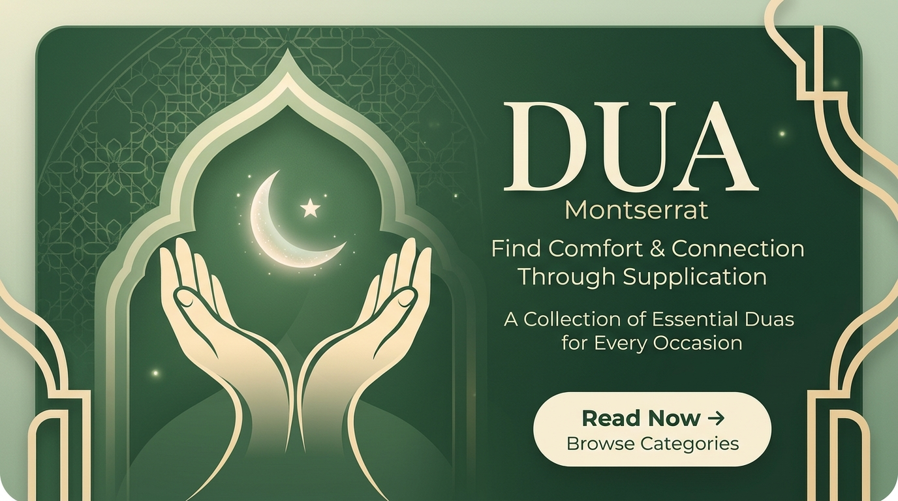

# Dua (ദുആ) — ഇസ്ലാമിക് ദുആ ആപ്പ്

ലളിതവും മനോഹരവും ഉപയോഗിക്കാൻ വളരെ എളുപ്പവുമായ ഒരു ഇസ്ലാമിക് ദുആ വെബ് & നേറ്റീവ് ആപ്പ് (UI/UX). കുട്ടികൾക്കും മുതിർന്നവർക്കും ഒരുപോലെ അനായാസം ഉപയോഗിക്കാൻ കഴിയുന്ന വിധം ശാന്തവും പ്രീമിയം നിലവാരമുള്ളതുമായ ഡിസൈൻ.



---

## 🌟 പ്രധാന സവിശേഷതകൾ (Key Features)

### 1. 🎨 ശാന്തവും പ്രീമിയവുമായ ഡിസൈൻ സ്റ്റൈൽ
- **വർണ്ണങ്ങൾ:**
  - പ്രധാന നിറം (Primary): ഫോറസ്റ്റ് ഗ്രീൻ `#176B50`
  - പശ്ചാത്തല നിറം (Background): ഇളം ക്രീം `#FAF9F4`
  - രണ്ടാമത്തെ നിറം (Secondary): സോഫ്റ്റ് സേജ് ഗ്രീൻ `#E7EFE5`
- **ഫോണ്ടുകൾ:** അറബിക് ടെക്സ്റ്റിന് *Noto Naskh Arabic*, മലയാളത്തിന് *Noto Sans Malayalam*, ഇംഗ്ലീഷിന് *Plus Jakarta Sans*.
- **ഡാർക്ക് മോഡ് & ലൈറ്റ് മോഡ്:** രാത്രി വായനയ്ക്ക് അനുയോജ്യമായ ഡാർക്ക് മോഡ് സപ്പോർട്ട്.
- **റെസ്പോൺസീവ് വ്യൂ:** മൊബൈൽ ആപ്പ് ഫ്രെയിമിലും ഫുൾ സ്ക്രീൻ മോഡിലും ഉപയോഗിക്കാം.

### 2. 📱 പ്രധാന 4 സ്ക്രീനുകൾ

1. **ദുആകൾ (Duas / Categories) — പ്രധാന സ്ക്രീൻ**
   - തത്സമയ സെർച്ച് ബാർ (മലയാളത്തിലും ഇംഗ്ലീഷിലും അറബിയിലും തിരയാം).
   - **“ഇന്നത്തെ ദുആ” (Dua of the Day)** ഹീറോ കാർഡ് (ഓഡിയോ, അർത്ഥം, ഫേവറിറ്റ്).
   - 8 പ്രധാന വിഭാഗങ്ങൾ (Categories) അല്ലെങ്കിൽ എല്ലാ ദുആകളും (All Duas) കാണാനുള്ള ടോഗിൾ.
   - 8 പ്രധാന വിഭാഗങ്ങൾ:
     1. ദൈനംദിന ജീവിതം (ഭക്ഷണം, വസ്ത്രം, ഭവനം, കണ്ണാടി...)
     2. പ്രഭാതവും സായാഹ്നവും (സയ്യിദുൽ ഇസ്തിഗ്ഫാർ, ആയത്തുൽ കുർസി...)
     3. ഉറങ്ങുന്നതിന് മുമ്പും ഉണരുമ്പോഴും
     4. നമസ്കാരവും ആരാധനയും (വുദു, പള്ളി, സുജൂദ്, ഖുനൂത്...)
     5. കുടുംബം (മാതാപിതാക്കൾ, ഭാര്യ, മക്കൾ...)
     6. യാത്ര (വാഹനത്തിൽ കയറുമ്പോൾ, യാത്രാ ദുആ...)
     7. സംരക്ഷണത്തിനുള്ള ദുആകൾ (കണ്ണേറ്, കടം, വിഷമം, രോഗം...)
     8. പാപമോചനത്തിനുള്ള ദുആകൾ (യൂനുസ് നബിയുടെ ദുആ, തൗബ...)

3. **ദുആ വിശദാംശങ്ങൾ (Dua Detail Screen)** — *ഏറ്റവും പ്രധാന സ്ക്രീൻ*
   - വ്യക്തമായ വലിയ അറബി എഴുത്ത് (വലിപ്പം ഇഷ്ടാനുസരണം മാറ്റാം - 20px മുതൽ 42px വരെ).
   - അറബി ഉച്ചാരണത്തിനുള്ള ട്രാൻസ്ലിറ്ററേഷൻ (Transliteration).
   - മലയാളത്തിലുള്ള ആധികാരികമായ അർത്ഥം.
   - ലളിതമായ ഇംഗ്ലീഷ് അർത്ഥം.
   - വിശ്വസനീയമായ ഖുർആൻ / ഹദീസ് റഫറൻസുകൾ (സഹീഹ് ബുഖാരി, മുസ്ലിം, തിർമുദി, അബൂദാവൂദ് മുതലായവ).
   - **ഓഡിയോ പ്ലെയർ:** യഥാർത്ഥ ഖാരിഅ് പാരായണം (OpenDua ഔദ്യോഗിക റെസിറ്റേഷൻ — മുഹമ്മദ് ജുമുഅ & മിശാരി അൽ-അഫാസി), അതിവേഗ പ്ലേബാക്ക് (Fast HTML5 Audio), പ്ലേ/പോസ്, പുരോഗതി കാണിക്കുന്ന ബാർ (Scrubber), വേഗത മാറ്റൽ (0.8x, 1x, 1.25x), ഓട്ടോ ലൂപ്പ്.
   - **തസ്ബീഹ് കൗണ്ടർ:** ടാപ്പ് കൗണ്ടർ, ലക്ഷ്യം (Target Count), ഹാപ്റ്റിക് വൈബ്രേഷൻ & വിജയാഘോഷം.
   - ഷെയർ ബട്ടണും ക്ലിപ്പ്ബോർഡ് കോപ്പി സൗകര്യവും.

4. **ഫേവറിറ്റ്സ് (Favorites)**
   - ഇഷ്ടപ്പെട്ട ദുആകളുടെ ലിസ്റ്റ്.
   - കാറ്റഗറി അടിസ്ഥാനമാക്കിയുള്ള ഫിൽട്ടറുകൾ.
   - സെർച്ച് സൗകര്യം.
   - **100% ഓഫ്ലൈൻ പ്രവർത്തനം**.

5. **സെറ്റിങ്സ് (Settings)**
   - അറബിക് ഫോണ്ട് സൈസ് സ്ലൈഡറും ലൈവ് പ്രിവ്യൂവും.
   - ഉച്ചാരണം, മലയാളം, ഇംഗ്ലീഷ് അർത്ഥങ്ങൾ ഓൺ/ഓഫ് ചെയ്യാനുള്ള ടോഗിളുകൾ.
   - ഓഡിയോ പ്ലേബാക്ക് സ്പീഡും റിപ്പീറ്റ് ക്രമീകരണങ്ങളും.
   - ലൈറ്റ് / ഡാർക്ക് തീം മാറ്റം.
   - ദൈനംദിന റിമൈൻഡർ ക്രമീകരണങ്ങൾ.
   - ആധികാരിക സ്രോതസ്സുകളെക്കുറിച്ചുള്ള വിവരണം.

---

## 🚀 ആപ്പ് പ്രവർത്തിപ്പിക്കുന്ന വിധം (How to Run)

```bash
# 1. പ്രൊജക്റ്റ് ഡയറക്ടറിയിലേക്ക് മാറുക
cd "Dua-App"

# 2. ഡിപൻഡൻസികൾ ഇൻസ്റ്റാൾ ചെയ്യുക (ആദ്യതവണ മാത്രം)
npm install

# 3. ഡെവലപ്‌മെന്റ് സെർവർ പ്രവർത്തിപ്പിക്കുക
npm run dev

# 4. പ്രൊഡക്ഷൻ ബിൽഡ് എടുക്കാൻ
npm run build
```

ബ്രൗസറിൽ `http://localhost:5174/` (അല്ലെങ്കിൽ ടെർമിനലിൽ കാണിക്കുന്ന ലിങ്ക്) തുറക്കുക.
